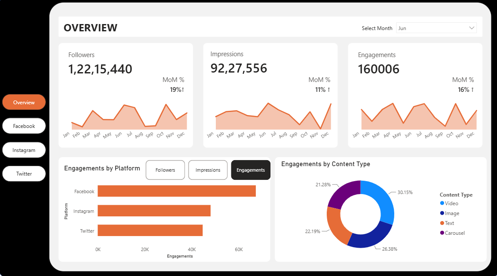
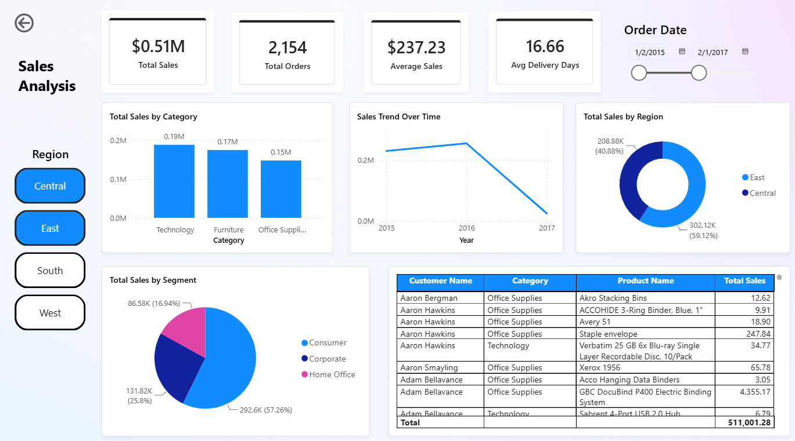
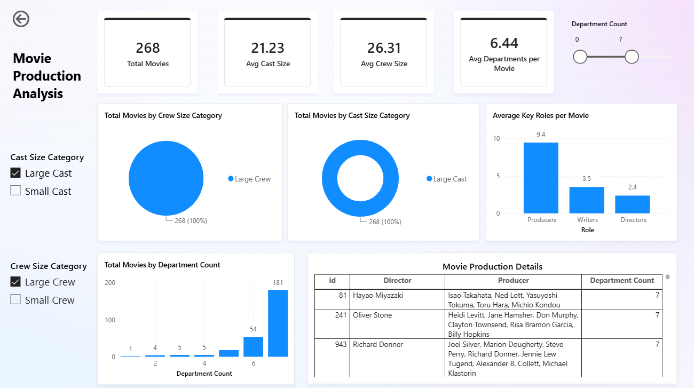
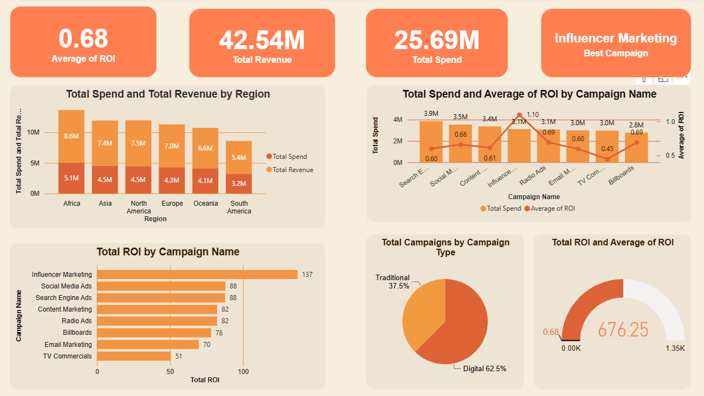

# Power BI Analytics & Business Intelligence Portfolio

Welcome to the Power BI Dashboards Portfolio. This repository contains a collection of interactive, data-driven Power BI dashboards designed to analyze, visualize, and extract key business insights from various domains, including marketing campaigns, sales performance, movie production metadata, and social media engagement.

Each dashboard showcases a combination of key performance indicators (KPIs), interactive slicers, advanced visualizations, and professional design layouts to enable stakeholders to make informed, data-backed decisions.

---

## 📁 Repository Structure

The project files are structured as follows:

*   **PBIX Files (Power BI Desktop Files):**
    *   [`campaign_performance.pbix`](file:///d:/learning/college/sem-6/powerbi/project/campaign_performance.pbix) - Marketing Campaign analysis.
    *   [`sales_and_movie_productions.pbix`](file:///d:/learning/college/sem-6/powerbi/project/sales_and_movie_productions.pbix) - Multi-page report covering both Movie Production and Sales Analysis.
    *   [`social_media_analysis.pbix`](file:///d:/learning/college/sem-6/powerbi/project/social_media_analysis.pbix) - Social Media account performance and engagement dashboard.
*   **Screenshots & Visual Assets:**
    *   [`campaign_performance.png`](file:///d:/learning/college/sem-6/powerbi/project/campaign_performance.png)
    *   [`movie_credits.png`](file:///d:/learning/college/sem-6/powerbi/project/movie_credits.png)
    *   [`sales.png`](file:///d:/learning/college/sem-6/powerbi/project/sales.png)
    *   [`social_media_analysis.png`](file:///d:/learning/college/sem-6/powerbi/project/social_media_analysis.png)

---

## 📊 Dashboard Overviews

### 1. Social Media Performance Dashboard
* **Source File:** [`social_media_analysis.pbix`](file:///d:/learning/college/sem-6/powerbi/project/social_media_analysis.pbix)
* **Visual Representation:**
  
  

#### Description & Features:
The **Social Media Analysis** dashboard provides a high-level overview of account engagement, growth, and audience interactions across three major social media platforms: Facebook, Instagram, and Twitter. 

*   **Dynamic Navigation:** Features an intuitive side-navigation menu allowing users to toggle views between the main **Overview** and platform-specific views (**Facebook**, **Instagram**, **Twitter**).
*   **Time-Series Insights:** A dropdown filter at the top right enables users to filter analytics by specific months (e.g., **June**).
*   **Core KPI Cards:**
    *   **Followers:** Currently at **1,22,15,440** (representing a strong **19% Month-over-Month (MoM) growth**).
    *   **Impressions:** Totaling **92,27,556** (with an **11% MoM increase**).
    *   **Engagements:** Reached **1,60,006** (showing a **16% MoM increase**).
    *   *Note:* Each card is accompanied by an embedded area sparkline visualizing trends over the preceding months.
*   **Engagements by Platform:** A horizontal bar chart demonstrating engagement distribution:
    *   **Facebook:** Leads with the highest engagement (~68K).
    *   **Instagram:** Follows next (~49K).
    *   **Twitter:** Third (~45K).
    *   Users can toggle this visual dynamically between **Followers**, **Impressions**, and **Engagements** via custom buttons.
*   **Content Type Distribution:** A donut chart showing which content formats drive engagement:
    *   **Video:** 30.15% (Primary engagement driver)
    *   **Image:** 26.38%
    *   **Text:** 22.19%
    *   **Carousel:** 21.28%

---

### 2. Sales & Movie Production Analysis Report
* **Source File:** [`sales_and_movie_productions.pbix`](file:///d:/learning/college/sem-6/powerbi/project/sales_and_movie_productions.pbix)
* **Pages:** This multi-page report comprises two distinct operational dashboards: **Sales Analysis** and **Movie Production Analysis**, sharing a cohesive design language.

#### Page A: Sales Analysis Dashboard
* **Visual Representation:**

  

*   **Overview:** Focuses on tracking orders, categories, and regional performance trends.
*   **Core KPI Cards:**
    *   **Total Sales:** **$0.51M**
    *   **Total Orders:** **2,154**
    *   **Average Sales:** **$237.23**
    *   **Avg Delivery Days:** **16.66 days**
*   **Interactivity & Filters:**
    *   **Region Selector:** Left-hand buttons filter the dashboard by regions (e.g., **Central** and **East** are currently selected).
    *   **Order Date Slider:** Filter records across custom date ranges (e.g., *1/2/2015 to 2/1/2017*).
*   **Key Visuals:**
    *   **Sales by Category:** Shows Technology leads with **$0.19M**, followed by Furniture (**$0.17M**) and Office Supplies (**$0.15M**).
    *   **Sales Trend Over Time:** Line chart depicting year-over-year sales performance (2015 - 2017).
    *   **Sales by Region:** Donut chart highlighting regional distribution (East accounts for **$302.12K / 59.12%**, Central for **$208.88K / 40.88%**).
    *   **Sales by Segment:** Pie chart representing customer segment breakdown (Consumer: **57.26%**, Corporate: **25.8%**, Home Office: **16.94%**).
    *   **Customer Details Table:** Deep dive table detailing customer transactions, products, and individual sales amounts.

#### Page B: Movie Production Analysis Dashboard
* **Visual Representation:**

  

*   **Overview:** Provides insights into studio production metrics, cast/crew sizes, and creative departments.
*   **Core KPI Cards:**
    *   **Total Movies:** **268**
    *   **Avg Cast Size:** **21.23 members**
    *   **Avg Crew Size:** **26.31 members**
    *   **Avg Departments per Movie:** **6.44 departments**
*   **Interactivity & Filters:**
    *   **Slicers:** Left panel filters for **Cast Size Category** (Large Cast vs. Small Cast) and **Crew Size Category** (Large Crew vs. Small Crew).
    *   **Department Count Slider:** Interactive range selection for departments associated with movies.
*   **Key Visuals:**
    *   **Average Key Roles per Movie:** Column chart displaying average occurrences of major roles (Producers: **9.4**, Writers: **3.5**, Directors: **2.4**).
    *   **Movies by Department Count:** Bar chart showcasing the concentration of departments involved (181 movies leverage 7 departments, 54 leverage 6 departments).
    *   **Movie Production Details Table:** Granular grid showcasing specific movie IDs, Directors, Producers, and Department Counts.

---

### 3. Marketing Campaign Performance Dashboard
* **Source File:** [`campaign_performance.pbix`](file:///d:/learning/college/sem-6/powerbi/project/campaign_performance.pbix)
* **Visual Representation:**

  

#### Description & Features:
This dashboard evaluates marketing campaigns to optimize advertising spend and maximize Return on Investment (ROI).

*   **Core KPI Cards:**
    *   **Average of ROI:** **0.68**
    *   **Total Revenue:** **$42.54M**
    *   **Total Spend:** **$25.69M**
    *   **Best Campaign:** **Influencer Marketing**
*   **Key Visuals:**
    *   **Total Spend and Total Revenue by Region:** Stacked bar chart comparing cost and profit across geographical territories. *Africa* led revenue generation at **$8.6M** (on a **$5.1M** spend), followed closely by *North America* and *Asia*.
    *   **Total Spend and Average ROI by Campaign:** Combined chart evaluating campaign viability. Shows that while *Search Engine Ads* had the highest total spend ($3.9M), **Influencer Marketing** produced the highest average ROI (**1.10**).
    *   **Total ROI by Campaign Name:** Bar chart ranking campaign formats by cumulative ROI performance (Influencer Marketing: **137**, Social Media Ads: **88**, Search Engine Ads: **88**).
    *   **Total Campaigns by Campaign Type:** Pie chart detailing the split between **Digital** marketing (62.5%) and **Traditional** channels (37.5%).
    *   **Total ROI and Average ROI Gauge:** Quick visual indicator tracking overall campaign effectiveness and targets.

---

## 🛠️ How to Open and Interact

To view, edit, or interact with these reports locally:

1.  **Download and Install Power BI Desktop:** Ensure you have the latest version of [Microsoft Power BI Desktop](https://powerbi.microsoft.com/desktop/) installed.
2.  **Clone or Download this Repository:** Get the files onto your machine.
3.  **Open the `.pbix` Files:**
    *   Double-click any of the `.pbix` files (e.g., `social_media_analysis.pbix`) to launch them in Power BI Desktop.
4.  **Explore the Interactivity:** Click on the slicers, charts, and buttons to see cross-filtering, tooltips, and page navigation in action!
